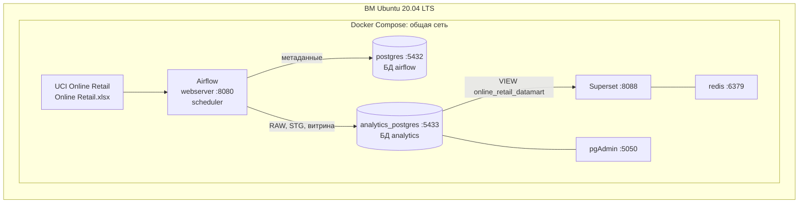
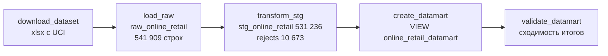
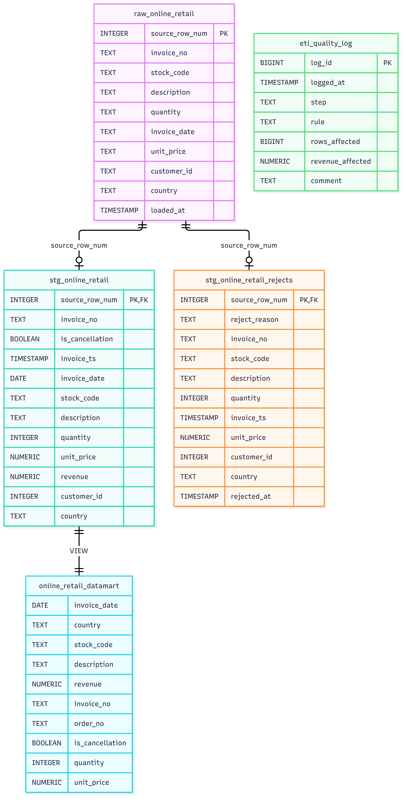
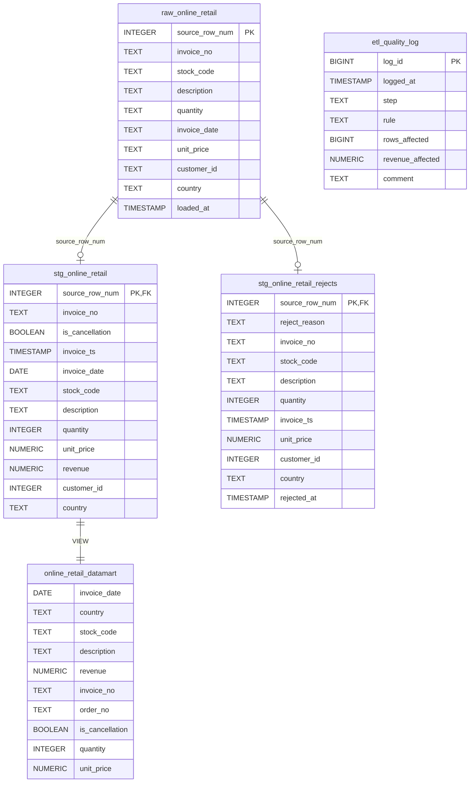
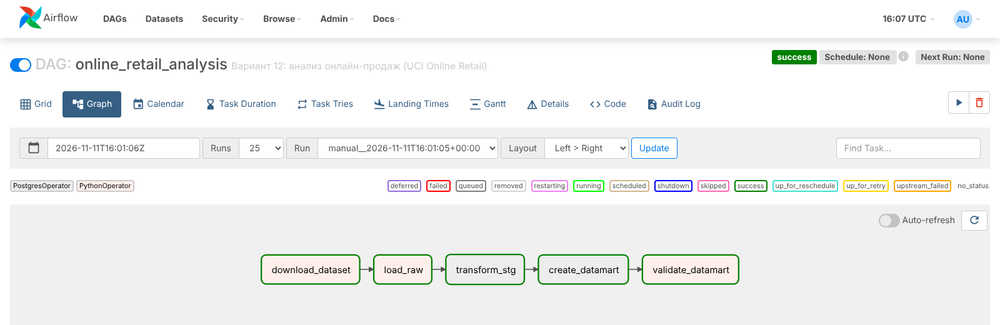
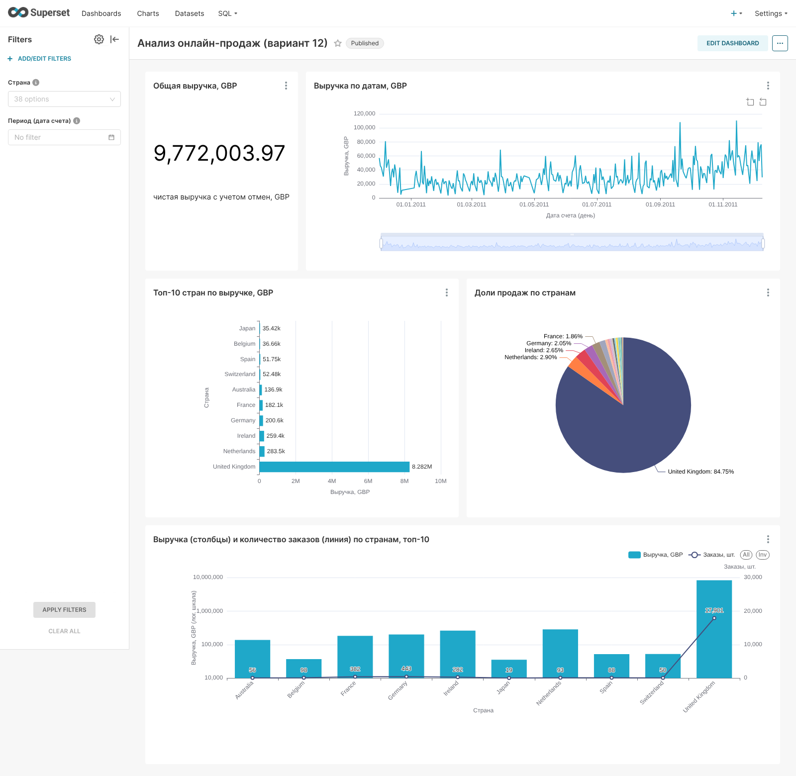
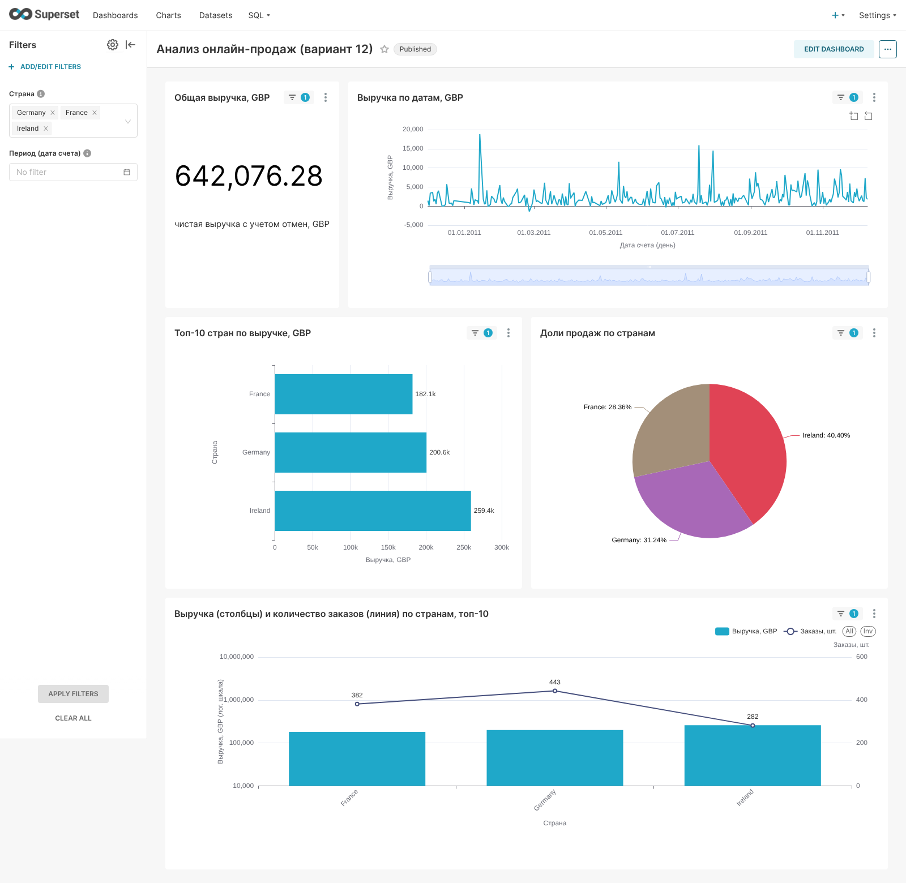

# Лабораторная работа 3. Аналитический дашборд для бизнес-кейса On-premise (VM)

**Вариант 12. Анализ онлайн-продаж** (набор данных UCI Online Retail)

Сквозной конвейер: UCI Online Retail -> Apache Airflow -> PostgreSQL (RAW -> STG -> витрина) -> Apache Superset.

## Содержание

1. [Цель работы](#1-цель-работы)
2. [Исследуемые метрики бизнес-процесса](#2-исследуемые-метрики-бизнес-процесса)
3. [Архитектура решения](#3-архитектура-решения)
4. [Технологический стек](#4-технологический-стек)
5. [ER-диаграмма базы данных](#5-er-диаграмма-базы-данных)
6. [Ссылки на исходный код](#6-ссылки-на-исходный-код)
7. [Описание проделанной работы](#7-описание-проделанной-работы)
8. [Выводы по анализу](#8-выводы-по-анализу)
9. [Быстрый старт и воспроизведение](#9-быстрый-старт-и-воспроизведение)

---

## 1. Цель работы

Британский интернет-магазин подарочных товаров продает через сайт розничным и оптовым покупателям из 38 стран. Бизнес-вопрос варианта: **откуда приходит выручка и как она распределена во времени**, чтобы решить, на каких рынках наращивать продажи и как планировать запасы и маркетинг по сезонам.

По дашборду принимаются три решения:

- какие зарубежные рынки поддерживать в первую очередь (по выручке и по числу заказов);
- когда готовить склад и рекламу к пиковому спросу (по динамике выручки по датам);
- насколько бизнес зависит от одного рынка (по долям стран).

Для ответа построен воспроизводимый конвейер в Docker на ВМ Ubuntu 20.04: данные автоматически скачиваются, проходят слои RAW и STG с журналом отбраковки, попадают в витрину (VIEW), к которой подключен интерактивный дашборд из пяти обязательных типов чартов с фильтрами.

## 2. Исследуемые метрики бизнес-процесса

Исходные поля набора: `InvoiceNo`, `StockCode`, `Description`, `Quantity`, `InvoiceDate`, `UnitPrice`, `CustomerID`, `Country` (541 909 строк, 01.12.2010-09.12.2011, цены в фунтах стерлингов).

| Метрика | Как считается | Исходные поля | Управленческий вопрос |
|---|---|---|---|
| Выручка строки `revenue` | `Quantity × UnitPrice`, без округления (тип NUMERIC) | Quantity, UnitPrice | Базовая величина для всех чартов |
| Общая выручка (индикатор) | `SUM(revenue)` по витрине | Quantity, UnitPrice | Каков чистый оборот за период и после фильтров |
| Выручка по датам (линия) | `SUM(revenue)` с группировкой по `invoice_date` (день) | InvoiceDate | Есть ли сезонность и пики, когда готовить запасы |
| Топ-10 стран (столбцы) | `SUM(revenue)` по `country`, сортировка по убыванию, 10 строк | Country | Какие рынки приносят больше всего денег |
| Доли продаж по странам (круговая) | `SUM(revenue)` страны / общая выручка | Country | Насколько велика зависимость от одного рынка |
| Количество заказов (линия комбинированного чарта) | `COUNT(DISTINCT order_no)`, где `order_no` = InvoiceNo без отмен | InvoiceNo | Сколько покупок делает рынок и каков средний чек |

**Правило для отмен и возвратов (явный выбор варианта).** Счета с префиксом `C` (отмены и возвраты) остаются в витрине с отрицательной выручкой, поэтому все чарты показывают **чистую выручку**: проданное минус возвращенное. Без этого отмененная продажа считалась бы дважды: например, заказ 80 995 шт. "PAPER CRAFT, LITTLE BIRDIE" 09.12.2011 был отменен в тот же день и в чистой выручке взаимно гасится. В числе заказов отмены не учитываются (`order_no` для них NULL).

**Правила очистки (слой STG).** Каждая удаленная строка сохраняется в таблице `stg_online_retail_rejects` с кодом причины, итоги пишутся в `etl_quality_log`.

| Код | Правило | Строк | Причина |
|---|---|---|---|
| R1 | `UnitPrice <= 0` | 2 517 | Корректировки остатков, списания, "Adjust bad debt": это не продажа, выручки нет |
| R2 | Служебные коды `AMAZONFEE`, `BANK CHARGES`, `CRUK`, `B`, `M`, `D`, `S`, `PADS`, `POST`, `DOT`, `C2` | 2 899 | Комиссии, банковские сборы, ручные корректировки, скидки, образцы, доставка - не товар, а витрина описывает продажи товаров по `stock_code` |
| R3 | Полный дубль строки источника (все 8 полей совпадают), остается первое вхождение | 5 257 | Технические повторы выгрузки |
| | **Итого отброшено** | **10 673** (1,97%) | |

**Нормализация категориальных полей.** `Description` очищен от пробелов по краям и двойных пробелов, приведен к верхнему регистру; для каждого `stock_code` выбрано одно наименование (самое частое), потому что в источнике у одного товара встречается несколько вариантов текста. Названия стран: `EIRE` -> `Ireland`, `RSA` -> `South Africa`, `USA` -> `United States`. Пропуски `CustomerID` не заполнялись нулями, поле в витрину не входит.

**Поля витрины.** Обязательные поля варианта `invoice_date`, `country`, `stock_code`, `description`, `revenue` присутствуют. Добавлены `invoice_no`, `order_no`, `is_cancellation`, `quantity`, `unit_price`: без номера счета нельзя посчитать количество заказов для комбинированного чарта.

## 3. Архитектура решения

Среда выполнения - виртуальная машина Ubuntu 20.04 LTS, на ней Docker Engine и Docker Compose. Все сервисы поднимаются одной командой `docker compose up -d` и находятся в общей сети Compose, обращаясь друг к другу по именам сервисов.

| Контейнер | Образ | Порт на ВМ | Роль |
|---|---|---|---|
| `init` | lpw03-airflow (на базе apache/airflow:2.5.0-python3.8) | - | Однократно: схема БД Airflow, пользователь admin, подключение `analytics_postgres` |
| `webserver` | lpw03-airflow | 8080 | Веб-интерфейс Airflow |
| `scheduler` | lpw03-airflow | - | Планировщик и исполнение задач DAG |
| `postgres` | postgres:12-alpine | 5432 | Метаданные Airflow |
| `analytics_postgres` | postgres:12-alpine | 5433 | Аналитическая БД `analytics`: RAW, STG, витрина |
| `superset` | lpw03-superset (на базе apache/superset:3.1.1) | 8088 | Чарты и дашборд |
| `redis` | redis:7-alpine | 6379 | Кэш Superset |
| `pgadmin` | dpage/pgadmin4 | 5050 | Администрирование и проверка БД |



ETL-конвейер (DAG `online_retail_analysis`) и слои данных:



| Слой | Объект | Содержание |
|---|---|---|
| RAW | `raw_online_retail` | Копия xlsx без изменений, все поля TEXT, плюс номер строки источника `source_row_num` |
| STG | `stg_online_retail`, `stg_online_retail_rejects`, `etl_quality_log` | Типы приведены, категории нормализованы, отбракованные строки с причиной, журнал качества |
| DATAMART | `online_retail_datamart` (VIEW) | Поля для дашборда; Superset подключен только к ней |

Задачи DAG:

1. `download_dataset` - скачивает архив `https://archive.ics.uci.edu/static/public/352/online+retail.zip` и распаковывает `Online Retail.xlsx` в `dags/data`; если файл уже есть, повторно не качает.
2. `load_raw` - читает xlsx как текст и загружает в `raw_online_retail` командой COPY, сверяет число строк.
3. `transform_stg` - выполняет `dags/sql/stg_online_retail.sql`: типизация, нормализация, правила R1-R3, журнал.
4. `create_datamart` - выполняет `dags/datamart_variant_12.sql`.
5. `validate_datamart` - проверки сходимости; при расхождении задача падает.

## 4. Технологический стек

| Уровень | Технология | Версия |
|---|---|---|
| Хост | Ubuntu | 20.04 LTS |
| Контейнеризация | Docker Engine / Docker Compose | 20.10+ / v2 |
| Оркестрация | Apache Airflow (LocalExecutor) | 2.5.0, Python 3.8 |
| Хранение | PostgreSQL | 12 (alpine) |
| Визуализация | Apache Superset | 3.1.1 |
| Кэш | Redis | 7 |
| Администрирование | pgAdmin 4 | latest |
| Источник данных | UCI Machine Learning Repository, Online Retail (id 352) | файл xlsx, 541 909 строк |
| Обработка | pandas / openpyxl / requests / SQLAlchemy | 1.5.2 / 3.1.2 / 2.28.1 / 1.4.44 |
| Интеграция с БД | apache-airflow-providers-postgres, psycopg2 | 5.3.1 / 2.9.5 |

Для варианта 12 Kaggle API не нужен: набор опубликован на UCI в открытом доступе, поэтому вместо `setup_kaggle.sh` используется `setup.sh` (создает рабочую папку `dags/data` и локальный файл `.env` с UID пользователя и случайным ключом `SUPERSET_SECRET_KEY`).

Секреты в репозиторий не попадают: `docker-compose.yml` берет `SUPERSET_SECRET_KEY` из переменной окружения, сам ключ хранится только в `.env`, а `.env` внесен в `.gitignore`. Без ключа `docker compose` не запустится и подскажет выполнить `./setup.sh`.

## 5. ER-диаграмма базы данных





Каждая строка RAW попадает ровно в одну из двух таблиц: `stg_online_retail` или `stg_online_retail_rejects` (связь по `source_row_num`). Витрина - представление над STG без потери строк.

## 6. Ссылки на исходный код

- DAG: [dags/online_retail_dag.py](dags/online_retail_dag.py)
- SQL витрины: [dags/datamart_variant_12.sql](dags/datamart_variant_12.sql)
- SQL слоя STG: [dags/sql/stg_online_retail.sql](dags/sql/stg_online_retail.sql)
- Экспорт дашборда Superset (JSON): [superset/dashboard_export.json](superset/dashboard_export.json)
- Экспорт дашборда Superset (ZIP для импорта в Superset 3.1.1, вместе с подключением и датасетом): [superset/dashboard_export.zip](superset/dashboard_export.zip)
- Окружение: [docker-compose.yml](docker-compose.yml), [Dockerfile](Dockerfile), [superset.Dockerfile](superset.Dockerfile), [requirements.txt](requirements.txt), [setup.sh](setup.sh), [cleanup.sh](cleanup.sh)

## 7. Описание проделанной работы

### 7.1. Граф успешно выполненного DAG

Все пять задач завершились со статусом success.



### 7.2. SQL-запрос витрины данных

```sql
DROP VIEW IF EXISTS online_retail_datamart;

CREATE VIEW online_retail_datamart AS
SELECT
    s.invoice_date,                                   -- дата счета (DATE)
    s.country,                                        -- страна покупателя
    s.stock_code,                                     -- код товара
    s.description,                                    -- наименование товара
    s.revenue,                                        -- выручка строки, GBP
    s.invoice_no,                                     -- номер счета
    CASE WHEN s.is_cancellation THEN NULL
         ELSE s.invoice_no END        AS order_no,    -- номер заказа (без отмен)
    s.is_cancellation,                                -- признак отмены/возврата
    s.quantity,                                       -- количество, шт.
    s.unit_price                                      -- цена за единицу, GBP
FROM stg_online_retail s;
```

Выручка строки рассчитывается в STG как `quantity * unit_price` в типе NUMERIC без округления; округление до копеек (пенсов) выполняется только при отображении, поэтому систематической ошибки округления нет.

### 7.3. Число записей на каждом шаге

| Шаг | Строк | Выручка, GBP |
|---|---|---|
| Источник (xlsx) и RAW | 541 909 | - |
| Отброшено по R1 (цена <= 0) | 2 517 | -22 124,12 |
| Отброшено по R2 (служебные коды) | 2 899 | -23 522,64 |
| Отброшено по R3 (дубли) | 5 257 | 21 390,72 |
| STG = витрина | 531 236 | 9 772 003,97 |
| в том числе строки отмен (оставлены с минусом) | 8 668 | -475 901,16 |

Проверки задачи `validate_datamart` (результаты в `etl_quality_log`): RAW = STG + отбраковка (541 909 = 531 236 + 10 673); число строк витрины = STG; общая выручка = сумме по странам = сумме по датам; число заказов (19 773) = сумме заказов по странам; в обязательных полях витрины нет NULL. Все проверки - OK.

### 7.4. Дашборд

Dataset в Superset построен на представлении `online_retail_datamart`. В датасете заданы метрики `revenue_total = SUM(revenue)` (формат `,.2f`, GBP) и `orders_count = COUNT(DISTINCT order_no)`.

| № | Тип | Название | Настройка |
|---|---|---|---|
| 1 | Индикатор (Big Number) | Общая выручка, GBP | `SUM(revenue)` |
| 2 | Линейная | Выручка по датам, GBP | X: `invoice_date`, гранулярность день; Y: `SUM(revenue)` |
| 3 | Столбчатая | Топ-10 стран по выручке, GBP | X: `country`, `SUM(revenue)`, сортировка по убыванию, лимит 10, горизонтально |
| 4 | Круговая | Доли продаж по странам | Измерение `country`, метрика `SUM(revenue)`, подписи "страна: %" |
| 5 | Комбинированная (Mixed Chart) | Выручка (столбцы) и количество заказов (линия) по странам, топ-10 | Запрос A: `SUM(revenue)`, столбцы, левая ось (логарифмическая); запрос B: `COUNT(DISTINCT order_no)`, линия, правая ось |

Фильтры дашборда (native filters, действуют на все 5 чартов): "Страна" (значения `country`, множественный выбор) и "Период (дата счета)".

Логарифмическая шкала левой оси комбинированного чарта выбрана потому, что выручка Великобритании (8,28 млн GBP) в 29 раз больше, чем у следующей страны, и на линейной шкале столбцы остальных рынков неразличимы. Это указано в подписи оси.

**Итоговый дашборд:**



**Работа фильтра** (Страна = Germany, France, Ireland): индикатор показывает 642 076,28 GBP, что равно сумме выручки трех стран из столбчатой диаграммы (200 619,66 + 182 076,60 + 259 380,02).



## 8. Выводы по анализу

**1. Сильная зависимость от домашнего рынка.** На Великобританию приходится 84,75% чистой выручки (8 282 076 GBP) и 90,5% заказов (17 901 из 19 773). Все остальные 37 стран вместе дают 15,25%. Магазин по сути британский, а зарубежные продажи остаются побочным каналом. Действие: при планировании роста ставить отдельные цели по экспортной выручке, потому что любая просадка британского спроса напрямую бьет по всему обороту.

**2. Зарубежные лидеры - оптовые покупатели.** Нидерланды (283 480 GBP, 93 заказа) и Австралия (136 923 GBP, 56 заказов) имеют средний чек 3 048 и 2 445 GBP против 463 GBP в Великобритании, то есть в 6,6 и 5,3 раза выше. Выручку там приносят немногочисленные крупные оптовики, поэтому потеря одного клиента заметно изменит показатель страны. Действие: для этих рынков вести персональную работу с ключевыми клиентами (условия опта, доставка), а не массовую рекламу.

**3. Германия и Франция - рынки с частыми средними заказами.** У Германии 443 заказа и 200 620 GBP, у Франции 382 заказа и 182 077 GBP при среднем чеке около 450-480 GBP, как в Великобритании. Покупательская база там шире, чем в Нидерландах. Действие: эти страны лучше всего подходят для масштабирования через маркетинг и локализацию сайта.

**4. Выраженная сезонность в конце года.** Выручка растет с сентября: сентябрь 1,01 млн, октябрь 1,06 млн, ноябрь 1,43 млн GBP. Эти три месяца дают 35,82% годовой выручки, ноябрь в 2,86 раза выше февраля. Пиковые дни - 14.11.2011 (110 624 GBP) и 20.09.2011 (108 277 GBP). Покупатели заранее закупают подарочные товары к Рождеству. Действие: формировать запасы и бюджет рекламы к августу-сентябрю, а не к декабрю.

**5. Отмены заметны.** Отмены и возвраты уменьшают валовую выручку на 4,64% (475 901 из 10 247 905 GBP), отмененных счетов 3 422. Действие: разобрать причины крупных отмен (часть из них - ошибочные оптовые заказы на десятки тысяч штук), ввести подтверждение для заказов с аномальным количеством.

**Ограничения данных:**

- отброшено 10 673 строки (1,97%) по правилам R1-R3, все они сохранены в `stg_online_retail_rejects`;
- исключены служебные коды, в том числе доставка `POST`/`DOT`/`C2` и комиссии Amazon `AMAZONFEE`, поэтому показатель описывает выручку от товаров, а не весь денежный поток;
- удаление полных дублей - допущение: часть совпадающих строк может быть реальными повторными позициями в одном счете;
- декабрь 2011 года неполный (данные до 09.12.2011, 8 торговых дней), на графике по месяцам он выглядит как спад, хотя дневная выручка не ниже ноябрьской;
- часть отмен в начале периода может относиться к продажам до 01.12.2010, которых нет в наборе, поэтому выручка первых недель может быть немного занижена;
- по субботам продаж нет (особенность работы магазина), это объясняет провалы на линейном графике;
- 500 строк имеют страну `Unspecified` или `European Community` (5 892 GBP), они оставлены как отдельные категории.

## 9. Быстрый старт и воспроизведение

```bash
# 1. Клонировать репозиторий на ВМ Ubuntu 20.04 с Docker Engine и плагином Compose
git clone <ссылка-на-репозиторий> && cd lpw_03

# 2. Подготовить рабочую папку и .env с секретным ключом Superset (токен Kaggle не нужен)
chmod +x setup.sh cleanup.sh && ./setup.sh

# 3. Собрать образы и запустить окружение
docker compose up -d --build
docker compose ps        # init - Exited (0), остальные - Up
```

| Сервис | Адрес | Учетные данные |
|---|---|---|
| Airflow | http://localhost:8080 | admin / admin |
| Superset | http://localhost:8088 | admin / admin |
| pgAdmin | http://localhost:5050 | admin@admin.com / admin |

**Подключение `analytics_postgres` в Airflow** создается контейнером `init` автоматически. Проверить его: Admin -> Connections -> `analytics_postgres` -> Test. Если подключения нет, создать вручную (кнопка +):

| Поле | Значение |
|---|---|
| Connection Id | analytics_postgres |
| Connection Type | Postgres |
| Host | analytics_postgres |
| Schema | analytics |
| Login | analytics |
| Password | analytics |
| Port | 5432 (внутренний порт контейнера, не 5433) |

**Запуск конвейера.** В Airflow включить DAG `online_retail_analysis` и нажать Trigger DAG. Загрузка xlsx (около 23 МБ) и задача `load_raw` занимают 1-2 минуты. Если ВМ не имеет доступа к archive.ics.uci.edu, положить файл `Online Retail.xlsx` в `dags/data` вручную: задача `download_dataset` его использует.

**Проверка в pgAdmin.** Добавить сервер: Host `analytics_postgres`, Port `5432`, БД/пользователь/пароль `analytics`. Должны быть таблицы `raw_online_retail`, `stg_online_retail`, `stg_online_retail_rejects`, `etl_quality_log` и представление `online_retail_datamart`. Контрольный запрос:

```sql
SELECT step, rule, rows_affected, revenue_affected, comment
FROM etl_quality_log ORDER BY log_id;
```

**Superset.**

1. Settings -> Database Connections -> + Database -> PostgreSQL: Host `analytics_postgres`, Port `5432`, Database `analytics`, Username `analytics`, Password `analytics`, Display Name `Analytics DB`.
2. Datasets -> + Dataset: база `Analytics DB`, схема `public`, представление `online_retail_datamart`. В свойствах датасета отметить `invoice_date` как временной столбец и добавить метрики `revenue_total` = `SUM(revenue)`, `orders_count` = `COUNT(DISTINCT order_no)`.
3. Создать пять чартов по таблице раздела 7.4 и собрать их на дашборде "Анализ онлайн-продаж (вариант 12)".
4. Добавить фильтры: Filters -> Add/Edit filters -> Value по столбцу `country` (имя "Страна") и Time range (имя "Период (дата счета)"), область действия - все чарты.

Вместо шагов 2-4 можно импортировать готовый дашборд: Dashboards -> Import dashboard -> `superset/dashboard_export.zip` (при импорте ввести пароль базы `analytics`).

**Очистка после сдачи:**

```bash
sudo ./cleanup.sh
```

### Структура репозитория

```
lpw_03/
├── dags/
│   ├── online_retail_dag.py        # DAG варианта 12
│   ├── datamart_variant_12.sql     # SQL-витрина (VIEW)
│   ├── sql/
│   │   └── stg_online_retail.sql   # слой STG и журнал отбраковки
│   └── data/                       # рабочая папка конвейера (в .gitignore)
├── screenshots/
│   ├── dag_graph.png               # граф успешно выполненного DAG
│   ├── dashboard.png               # итоговый дашборд
│   ├── dashboard_filtered.png      # дашборд с примененным фильтром
│   └── erd.png                     # ER-диаграмма
├── superset/
│   ├── dashboard_export.json       # экспорт дашборда (JSON)
│   └── dashboard_export.zip        # экспорт для импорта в Superset 3.1.1
├── docker-compose.yml
├── Dockerfile                      # образ Airflow с зависимостями
├── superset.Dockerfile             # образ Superset с драйвером PostgreSQL
├── requirements.txt
├── setup.sh                        # подготовка dags/data и .env (секреты)
├── cleanup.sh                      # очистка Docker-окружения
├── .gitignore
└── Readme.md
```
